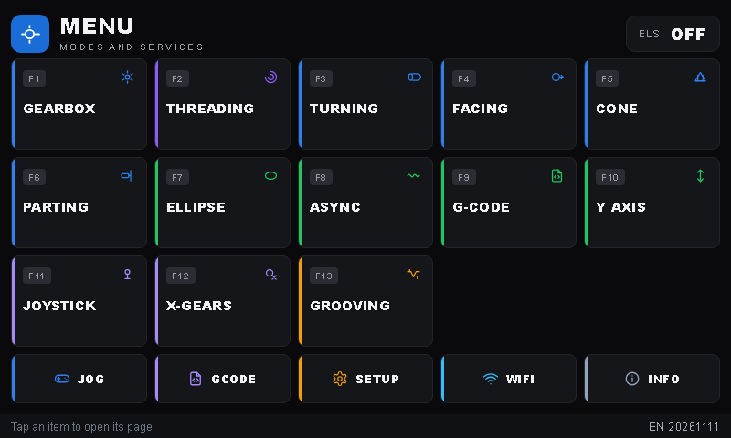
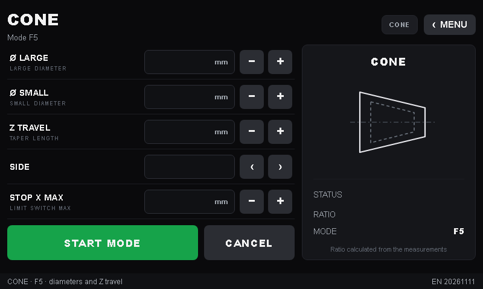
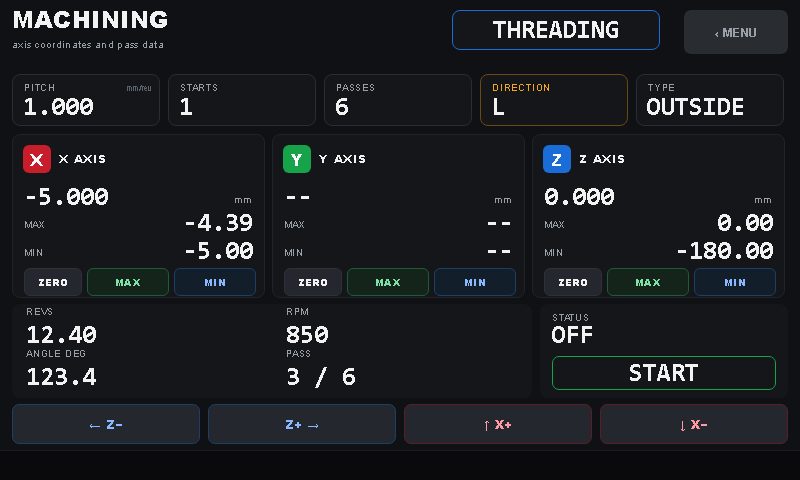

# NanoEls H5

English edition of the project. Original in Italian:
https://github.com/merletti/NanoEls-H5

**ELS** (Electronic Lead Screw) controller for a lathe, based on **ESP32-S3**,
with a **Nextion H5 800×480** display and a built-in **web interface** for
settings, G-code programs and updates.

It derives from [NanoEls](https://github.com/kachurovskiy/nanoels) by Maxim
Kachurovskiy (MIT license); this variant adds the H5 interface, card graphics on
the TFT, one-touch start of the machining and OTA updates of firmware and
display.

Project site: **[merletti.github.io/NanoEls-H5](https://merletti.github.io/NanoEls-H5/)** —
screens, modes and files to download (Italian edition).

> **Warning**: the project is provided **as is, without any warranty**. Anyone
> who builds, modifies or uses it accepts all risk and responsibility: the
> controller drives motors and moving parts. See [Disclaimer](#disclaimer).

> The project is being finished. The firmware compiles and runs on the
> controller, the English backgrounds are rendered, the web interface is
> translated and the English `.tft` is compiled; the physical lathe tests remain
> (see [Project status](#project-status)) before use on the machine.

## Download

Nothing has to be compiled to use the firmware: the binary is ready in
`03_firmware/` and the display interface `h5_en.tft` is ready in `02_display/`.
`02_display/GUIDA_TFT_EN.md` explains how to rebuild it in Nextion Editor.

| Item | File | Where |
|---|---|---|
| ESP32-S3 firmware (OTA update) | `h5-EN-20261111-v65.bin` | `03_firmware/` |
| Firmware source code | `h5_en.ino` | `03_firmware/` |
| Nextion display interface (compiled) | `h5_en.tft` | `02_display/` |
| Nextion Editor project | `h5_en.HMI` | `02_display/` |
| English backgrounds 800×480 | 20 `.png` files | `02_display/sfondi/` |
| How to rebuild the TFT | `GUIDA_TFT_EN.md` | `02_display/` |
| User manual | `MANUALE_USO_EN.md` | `04_documentazione/` |

Italian original and its releases:
[merletti/NanoEls-H5](https://github.com/merletti/NanoEls-H5).

How to load the files on the controller:
[Loading firmware and interface](#loading-firmware-and-interface).

## Features

- **13 working modes**: gearbox, X-gears, turning, facing, cone, parting,
  threading (including multi-start and tapered), ellipse, async, Y axis,
  joystick, grooving, G-code.
- **Nextion 800×480 display**: 22 card pages, live values drawn by the
  firmware, numeric keypad and text keyboard on the panel.
- **MACHINING page**: opens the current machining by itself; `STATUS/START`
  confirms the setup already entered and starts in one touch.
- **Web interface** (`http://<controller-ip>/`): positions, limit switches,
  motor parameters, WiFi, G-code programs including from `.gcode` files, backup
  and restore of the machine configuration, controller restart, firmware and
  TFT updates over OTA.
- **Work safety**: immediate STOP, emergency stops with a message on screen,
  limit switches mandatory in the modes that require them.
- **Persistent settings** in NVS: axes, limit switches, pitch, cone ratio,
  WiFi (the password is never shown: fields masked and empty).
- **Optional hardware**: handwheels, joystick, PS/2 keyboard.

## Images

| Menu | Cone | Machining |
|---|---|---|
|  |  |  |

## Hardware

- **MCU**: ESP32-S3, 4 MB flash (`min_spiffs` partition), PSRAM not required.
- **Display**: Nextion H5 800×480 connected over serial (115200 baud; first
  upload at 9600).
- **Spindle**: optical encoder (default 1200 pulses/rev) on GPIO 13/14.
- **Axes**: two stepper drivers (Z and cross X), Z and X limit switches.
- **Optional inputs**: handwheels, joystick, PS/2 keyboard.

The pins and default values (screw pitch, steps/rev, invert flags, maximum
travel) are at the top of [`03_firmware/h5_en.ino`](../03_firmware/h5_en.ino)
and can be overridden from the web interface without recompiling.

## Folder structure

```
00_README.md               what is here and what remains
01_glossario/              IT→EN glossary (web interface, TFT, documents)
02_display/                Nextion display
  sfondi/                  English backgrounds 800x480, all pages (20 PNG)
  pictures/                card strips (to rebuild the backgrounds)
  GUIDA_TFT_EN.md          how to rebuild h5_en.tft in Nextion Editor (step by step)
  _sorgente/h5_it.HMI      Italian project used as the base
  h5_en.HMI                English Nextion Editor project (pictures 60–79)
  h5_en.tft                compiled English display interface
  screens_en.html          preview of all screens with English labels
  lavorazione_en.html      mock-up of the MACHINING page
03_firmware/               ESP32-S3 firmware
  h5_en.ino                source code (web interface + TFT driver)
  h5-EN-20261111-v65.bin   firmware for OTA update or Arduino IDE
  _sorgente/h5.ino         Italian firmware used as the translation base
  _build/                  translation generator, term tables, build output
04_documentazione/         documentation
  MANUALE_USO_EN.md        user manual
  MONTAGGIO_TORNIO_EN.md   lathe assembly and commissioning
  README_EN.md             this file
  cablaggio/               wiring schematic (HTML, PNG, A4 PDF)
LICENSE                    MIT license
```

## Building the firmware

You need [arduino-cli](https://arduino.github.io/arduino-cli/) with the
Espressif ESP32 core 3.x and two libraries:

```sh
arduino-cli core update-index --additional-urls https://espressif.github.io/arduino-esp32/package_esp32_index.json
arduino-cli core install esp32:esp32 --additional-urls https://espressif.github.io/arduino-esp32/package_esp32_index.json
arduino-cli lib install "WebSockets" "PS2KeyAdvanced"
```

Arduino requires the sketch folder to be named after the `.ino` file: create a
folder `h5_en`, put `h5_en.ino` inside it and compile:

```sh
arduino-cli compile \
  --fqbn "esp32:esp32:esp32s3:FlashSize=4M,PartitionScheme=min_spiffs,PSRAM=disabled" \
  h5_en
```

The binary is `h5_en/build/h5_en.ino.bin`; rename it to
`h5-EN-<date>-v65.bin` and load it as described below. Or open `h5_en.ino` in
Arduino IDE (board *ESP32S3 Dev Module*, 4 MB flash, `min_spiffs`, PSRAM
disabled).

| Item | Value |
|---|---|
| Binary | `h5-EN-20261111-v65.bin` (1,295,312 bytes) |
| SHA-256 | `75f38eb8c11e5d4f79238bce726534789deac09638b185217fd058acb241ef1b` |
| Toolchain | Arduino CLI 1.5.1, core `esp32` 3.3.12 |
| Size | sketch 1,295,165 bytes (65% of the app partition); RAM 57,456 bytes (17%) |

To regenerate the source, run `traduci_fw.pl` from `03_firmware/_build/` with
`_sorgente/h5.ino` and the eight tables in `01_glossario/`.

## Loading firmware and interface

1. **Firmware** (`.bin`): from the web interface, *Update ESP32 firmware*. The
   controller must be off (`ELS OFF`); it restarts by itself when done.
2. **Display** (`.tft`): from the web interface, *Update Nextion TFT*, or copy
   `h5_en.tft` to a microSD card as `h5.tft` (FAT32, root) and restart the
   display. The web interface uses 115200 baud; for a factory display or at the
   first upload, tick *First upload (9600 baud)*.

## First start

1. Turn the controller on: if no WiFi is saved, or the connection to the home
   network fails, the access point **`NanoEls-H5-Setup`** opens with password
   **`nanoels-h5`**.
2. Connect and open `http://192.168.4.1/`, enter the SSID and password of the
   home network and save; the controller restarts.
3. Open the web interface at the address shown on the INFO/WIFI page of the
   display and set positions, limit switches and axis parameters.

The access point password is for the initial setup only: do not leave it active
on public networks.

## Documentation

- [User manual](MANUALE_USO_EN.md) — modes, step-by-step procedures, messages,
  emergency stops.
- [Lathe assembly](MONTAGGIO_TORNIO_EN.md) — checklist from the bench to the
  machine: wiring, parameters, dry runs and machining tests.
- [Wiring schematic](cablaggio/schema_cablaggio_en.html) — connectors, pinout
  and power supply.
- [How to rebuild the TFT](../02_display/GUIDA_TFT_EN.md) — Nextion Editor,
  import of the English backgrounds, compilation of `h5_en.tft` and upload to
  the panel.

## Project status

Verified:

- compilation and start on ESP32-S3 (firmware H5V65, English edition
  `EN 20261111`);
- 22 TFT pages: English backgrounds on the visible pages, settings panel and
  text keyboard painted by the firmware, touch areas and values;
- setup and one-touch start logic for all modes;
- OTA update of firmware and display;
- loading G-code programs from files in the web interface;
- web interface in English (configuration, G-code, WiFi) and saving in NVS;
- normal STOPs tested on the bench (controller without axes mounted);
- English TFT compiled (`h5_en.tft`, 6,501,604 bytes): 20 pictures imported and
  assigned to the 22 pages (60–79), pages checked one by one in Nextion Editor.

Still to complete before use on the machine:

- physical lathe tests: Z/X synchronization, limit switches, spindle, passes,
  threading including tapered;
- check of live values during real machining;
- safety commissioning with the machine assembled: emergency during jog,
  general reset, STOP of a G-code program;
- test on a second machine/configuration;
- load `h5_en.tft` on the panel and check every page live (touch areas, values,
  keypad).

## Safety

- The web interface **has no login**: use it only on a trusted local network.
- The setup access point has a known password (`nanoels-h5`), meant for the
  initial configuration; it must not be left active on public networks.
- The controller drives motors: before every test move the tool away from the
  workpiece and keep the STOP within reach.

## Disclaimer

The project is distributed under the MIT license, **as is and without any
warranty**. Use is at your own risk. Anyone who builds, modifies or uses it
accepts all responsibility: the controller drives motors and moving parts, so a
wiring, parameter or software error can damage the machine or cause injury.
Before use, check the lathe safety devices, follow local regulations and never
leave the machine unattended during machining. The author assumes no liability
for damage to property, people or data loss resulting from use of the project.

## License

[MIT](../LICENSE). The project derives from NanoEls by Maxim Kachurovskiy (MIT,
2020): the original copyright notice is retained.

## Original project

This is the English edition of the NanoEls H5 project. Sources, history and
original instructions:
[kachurovskiy/nanoels — h5](https://github.com/kachurovskiy/nanoels/tree/main/h5).
Project video: [watch on YouTube](https://www.youtube.com/watch?v=thNJafjMl1Y).

Lathe assembly for this edition is described in
[MONTAGGIO_TORNIO_EN.md](MONTAGGIO_TORNIO_EN.md). The project is free, with no
paid features.

## Support the project

If the project was useful, you can buy the author a coffee with PayPal:
[Buy a coffee](https://www.paypal.com/biz/profile/officinamerletti).
Donations are optional: no feature is paid.

## Credits

- Maxim Kachurovskiy — [NanoEls](https://github.com/kachurovskiy/nanoels)
  project.
- Nextion — display and Nextion Editor.
- Arduino/ESP32 community for the libraries used.
